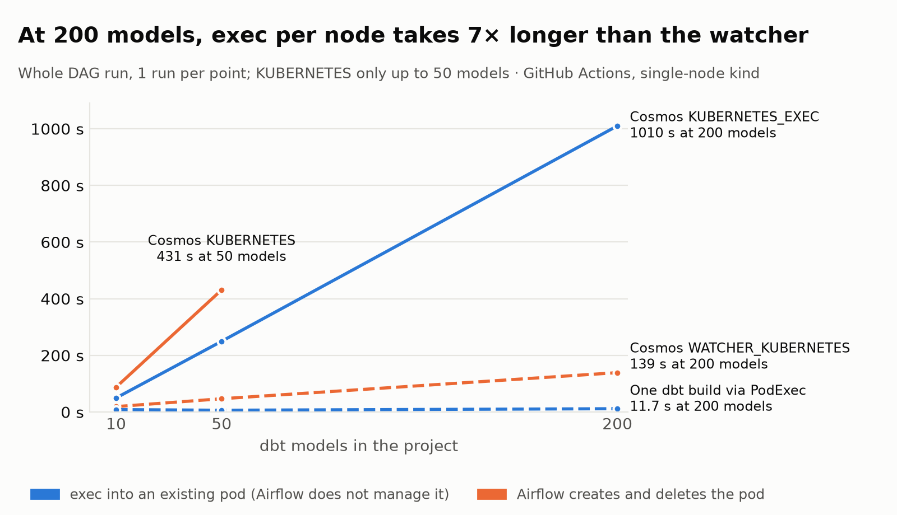

# airflow-pod-exec-duckdb-demo

[](https://github.com/aoelvp94/airflow-pod-exec-duckdb-demo/actions/workflows/e2e.yml)

Run dbt and ad-hoc SQL inside **one long-lived DuckDB pod** from Airflow, using
`KubernetesPodExecOperator` (cncf.kubernetes provider ≥ 10.22) instead of starting a new pod per task.
Everything runs locally on [kind](https://kind.sigs.k8s.io/), which stands in for AKS / EKS / GKE.

```
 Airflow (local, uv)                         kind cluster
 ───────────────────                         ───────────────────────────────────────────
 duckdb_dbt_exec DAG                          ns: duckdb
   dbt_seed ───────── exec ───────────┐       ┌──────────────────────────────────────┐
   dbt_build ──────── exec ───────────┼──────▶│ duckdb-dbt-0  (StatefulSet, 1 replica)│
   query_customer_revenue ─ exec ─────┘       │   dbt-duckdb + parsed dbt project    │
   report (local, reads XCom)                 │   /data/warehouse.duckdb  ◀── PVC    │
                                              └──────────────────────────────────────┘
 identity: ServiceAccount `airflow-exec` (get pods, pods/exec in `duckdb` only)
```

## Quick start

Needs Docker, kind, kubectl, uv and just.

```bash
just up        # kind cluster, image, pod, least-privilege kubeconfig, Airflow DB
just run       # airflow dags test duckdb_dbt_exec
just query "select * from customer_revenue order by revenue desc"
just test      # AKS-flavoured operator, Azure mocked, kind real
just bench 10  # exec vs pod-per-task latency + at-scale estimate
just compare 3 # same dbt project: hand-made exec vs Cosmos KUBERNETES_EXEC vs Cosmos KUBERNETES
just burst 50  # 50 pods created at once
just cancel    # cut an exec mid-run: does dbt stop in the pod?
just hang      # the exec connection hangs without closing
just parallel  # concurrent dbt builds: shared target/ vs a workspace each
just scale     # synthetic projects of 10/50/200 models, four ways each (CI: manual workflow "scale on kind")
just down
```

CI ([`.github/workflows/e2e.yml`](.github/workflows/e2e.yml)) runs all of the above on a fresh kind cluster on
every push and PR. The benchmark tables appear in the run's job summary and `bench/results/` is uploaded as an
artifact. To change the size, run it manually with the `bench_n` / `burst_pods` inputs.

Change a model, then `just reload` (rebuilds the image and restarts the pod; the PVC keeps the warehouse).

## Why a "forever pod"?

| | Pod per task (KPO / Cosmos KUBERNETES) | Exec into a long-lived pod (this repo) |
|---|---|---|
| Start-up per task | schedule + image pull + Python/dbt import + parse: ~10–60 s | ~1 s: process start in a warm container |
| DuckDB file | must be fetched/attached every time (object storage, RWX volume) | stays on the pod's PVC |
| Isolation | full: each task gets its own CPU/memory, crashes are contained | shared: a runaway query affects every task |
| Concurrency | scales out | **one writer at a time** (DuckDB is single-writer) → `duckdb_writer` pool, 1 slot |
| Sizing | per task | fixed by the pod's requests/limits |
| Failure mode | task pod fails, retries in a fresh pod | pod restart kills in-flight execs; tasks retry when it's back |
| Deploying dbt changes | new image tag per run | roll the StatefulSet (`just reload`) |

It's a good fit when you have many small, fast dbt/SQL steps against one embedded DuckDB file, and
pod start-up costs more than the work itself. It's a poor fit when tasks need isolation, run in parallel
with heavy writes, or need very different resource sizes. In those cases use KPO, or put DuckDB behind
something with a server (MotherDuck, or a DuckLake / Iceberg catalog that many readers can share).

Note: DuckDB is embedded, not a server. The pod doesn't serve queries. Each exec starts a short-lived
`dbt` or `python` process that opens the file. Read-only queries can run alongside each other, but a
writer needs the file to itself, which is why writers share a one-slot pool.

## Cosmos: per-node tasks, with or without a pod per task

[astronomer-cosmos#3027](https://github.com/astronomer/astronomer-cosmos/pull/3027) (open, unreleased) adds
`ExecutionMode.KUBERNETES_EXEC`: Cosmos keeps one Airflow task per dbt node, but runs each one with
`KubernetesPodExecOperator` in an existing pod instead of starting a new one. That's this repo's pattern, packaged
in Cosmos. [`dags/cosmos_dbt.py`](dags/cosmos_dbt.py) renders the same dbt project both ways from the
manifest baked into the image. `pyproject.toml` pins the PR's head commit until it ships in a release.

`just compare 3`, laptop with the lid open, same pod/image/pool for all three, tasks one after another:

| DAG | how | tasks | wall p50 |
|---|---|---:|---:|
| `duckdb_dbt_exec` | hand-made: seed + **one** `dbt build` exec (+ query, report) | 4 | **6.8 s** |
| `cosmos_dbt_kubernetes_exec` | Cosmos `KUBERNETES_EXEC`: exec per dbt node | 8 | **25.3 s** |
| `cosmos_dbt_kubernetes` | Cosmos `KUBERNETES`: new pod per dbt node | 8 | **56.9 s** |

- **Exec per node is about 2.2× faster than a new pod per node** (~2.3 s vs ~5–8 s per task). The whole difference
  is pod start-up, which grows in the cloud (image pulls, new nodes).
- **Per-node granularity still costs time.** Each Cosmos task starts a new `dbt` process that loads the
  project again (~2 s here). The PR's docs say so too: exec "removes Pod startup overhead, not dbt process
  startup or project parsing". One `dbt build` exec is the fastest, but you lose per-model tasks, retries and
  lineage in Airflow.
- **Pick by what you need in Airflow.** Per-model visibility and retries → Cosmos `KUBERNETES_EXEC` with a
  one-slot pool. Lowest latency → a few coarse exec tasks selected by tag. A new pod per node only pays off when
  tasks need isolation or their own resources.
- **For `KUBERNETES` mode on DuckDB**, the pods must mount the same volume, or each model is built into a
  throwaway file. That only works here because kind has a single node (ReadWriteOnce is per node). On a real
  cluster you'd need ReadWriteMany storage or a database with a server.

### How it grows with project size

`just scale` ([`dags/cosmos_scale.py`](dags/cosmos_scale.py)) runs synthetic projects of 10, 50 and 200 models
([`scale/gen.py`](scale/gen.py): layers 10 wide, each model a 10k-row table, so the time is dbt and Airflow, not
DuckDB). Each project runs four ways through a real scheduler. These numbers come from the manual CI workflow
*scale on kind*, one run per point:



| whole run | 10 models | 50 models | 200 models | per model |
|---|---:|---:|---:|---:|
| one `dbt build` exec | 8.5 s | 6.2 s | 11.7 s | ~0 s |
| Cosmos `WATCHER_KUBERNETES` | 19.0 s | 46.8 s | 138.9 s | 0.6 s |
| Cosmos `KUBERNETES_EXEC` | 49.6 s | 249.6 s | 1,010 s | 5.1 s |
| Cosmos `KUBERNETES` | 87.7 s | 431.0 s | not run (~29 min extrapolated) | 8.6 s |

| inside the pod (median of 3) | 10 models | 50 models | 200 models |
|---|---:|---:|---:|
| `dbt --version` | 2.04 s | 2.08 s | 2.09 s |
| `dbt parse` (partial, pre-parsed) | 2.74 s | 2.82 s | 2.91 s |
| `dbt parse --no-partial-parse` (full) | 3.80 s | 3.92 s | 4.40 s |

- **Exec per node grows linearly, about 5 s per model.** Each node pays a dbt start-up (~2 s), loading the
  partial parse and the exec itself, and the one-slot pool runs them one at a time. At 200 models that's 7× the
  watcher and 87× a single build.
- **The watcher grows slowly** (0.6 s per model). dbt starts once and runs with threads, so most of the
  growth comes from following the per-node sensors.
- **Parsing isn't what grows here.** A full parse of 200 models took 4.4 s, against 3.8 s for 10. These
  models are plain SQL with no YAML, macros or packages, though, and a real project of the same size parses
  slower. The point is that what grows is the dbt *process* started once per node, not the parse.
- **The pool is a DuckDB constraint.** With a warehouse that takes many writers, exec per node could run up to a
  layer's width (10 here) at once, which would cut its time a lot. That hasn't been measured.
- One run per point, so small differences are noise (the 50-model build was faster than the 10-model one).

## Measuring it

Three tools, from measured to estimated:

1. **`just bench N`** runs the DAG [`bench_exec_vs_kpo`](dags/bench_exec_vs_kpo.py): the same work N times as
   exec into the forever pod and N times as a `KubernetesPodOperator` pod with the same image and requests.
   Two workloads: `noop` (`python -c pass`, pure overhead) and `dbt` (`dbt build`, 2 seeds + 3 models + 5 tests).
   Tasks run one after another, so each duration is single-task latency, not contention.
   [`bench/report.py`](bench/report.py) reads durations from the Airflow DB.
2. **`just burst K`** ([`bench/burst.py`](bench/burst.py)) creates K pods at once, as a wide fan-out of KPO tasks
   would, and times create → scheduled → container started → finished from one watch stream.
3. **`just estimate …`** ([`bench/estimate.py`](bench/estimate.py)) scales the measured overheads to tasks/day.
   It adds the costs kind can't show (cold image pulls, waiting for a new node) as explicit assumptions and prices
   both options (Fargate list prices by default; override them). It prints which inputs were measured and which assumed.

Reference numbers. Both use single-node kind with the image already on the node, which is the **best case** for
pod-per-task. The CI numbers are the cleaner ones: a GitHub `ubuntu-latest` runner, 5 tasks per group. Local is an
Apple Silicon laptop, 3 tasks per group.

| p50 per task | exec into forever pod | new pod per task (KPO) | difference |
|---|---:|---:|---:|
| noop, CI | 0.07 s | 5.1 s | +5.1 s |
| `dbt build`, CI | 3.1 s | 7.1 s | +4.1 s (2.3×) |
| noop, laptop | 0.1 s | 5.5 s | +5.4 s |
| `dbt build`, laptop | 5.7 s | 11.2 s | +5.5 s (2.0×) |

| burst (pods created at once) | container started p50 / p95 | all finished |
|---|---:|---:|
| 50 pods, CI | 6.2 s / 7.2 s | 11.3 s |
| 30 pods, laptop | 2.5 s / 3.5 s | 5.0 s |
| 100 pods, laptop | 11.9 s / 14.3 s | 18.7 s |

Reading the estimate:

- **Latency is the clear win.** A new pod costs about 5 s even in the best case. In the cloud, add a cold image
  pull now and then, plus ~60 s when the autoscaler has to add a node. On a DAG with 10 sequential tasks, that's
  minutes per run.
- **Cost is not automatically a win.** A forever pod reserves its CPU and memory 24/7. With short tasks, paying
  per pod-second is cheaper until roughly 10k+ tasks/day (run `just estimate` with your numbers).
- **The single writer caps throughput.** One pod can run at most `86400 / task seconds` writing tasks per day.
  Near that limit you need several DuckDB files/pods (shard by domain) or a real multi-writer engine.
- **At scale, the control plane suffers first.** The burst shows start latency growing with the number of pods
  started at once (30 → 100 pods: p50 2.5 s → 12 s on one node). Thousands of short pods also mean API-server
  and etcd churn, events, and pod IPs. A forever pod creates none of that.
- **Under KubernetesExecutor**, every Airflow task already runs in a worker pod, so exec saves the *second*
  pod (worker + KPO pod → worker only), not all pod overhead.

### Cancelling an exec leaves dbt running in the pod

**`just cancel`** ([`bench/cancel.py`](bench/cancel.py)) starts a slow `dbt show` through
`KubernetesPodExecOperator` and cuts it after 10 s in two ways: `operator.on_kill()`, which Airflow calls on a
timeout or when the task is marked failed, and a SIGKILL of the client process, which stands in for a dead worker or
a dropped connection. Then it retries a `dbt run` straight away, and again after the first dbt exits.

| cut by | dbt kept running in the pod | immediate retry | retry once the first dbt exited |
|---|---|---|---|
| `operator.on_kill()` | yes | failed: `Could not set lock on file "/data/warehouse.duckdb": Conflicting lock is held in … (PID …)` | succeeded |
| SIGKILL of the client | yes | failed, same error | succeeded |

`on_kill()` only closes the exec connection. The Kubernetes exec API can't send a signal to the remote process, so
the command keeps running until it finishes. With DuckDB, the orphaned process keeps the write lock, so the
retry fails. With a warehouse that has no lock, the retry would run alongside the first attempt. Cosmos'
`KUBERNETES_EXEC` operators inherit this `on_kill`. Pod-per-task modes don't have the problem, because deleting the
pod kills the process. Setting `retry_delay` longer than your longest run avoids the lock error, but it doesn't stop
the orphan. The PR's docs already warn about this ("does not guarantee the remote dbt process stops").

### A hung exec connection blocks the task until it times out

**`just hang`** ([`bench/hang.py`](bench/hang.py)) sends the exec through a local TCP proxy. Mid-run, the proxy
stops moving bytes in both directions but keeps both sockets open, the way a silent network partition does.
On CI:

| dbt in the pod | `execute()` on its own | `on_kill()` while hung | retry once the network is back |
|---|---|---|---|
| finished 66 s after the freeze | still blocked after 150 s | returned in ~1 s | succeeded |

dbt finishes but its exit code never reaches Airflow, so the task can't tell whether the run worked. The operator's
read loop has no idle timeout and sends no pings, so the task waits for as long as the connection looks open (with
Linux's TCP keepalive defaults, that's hours). Set `execution_timeout` on exec tasks. Airflow then calls `on_kill()`,
which unblocks the task right away. The error the task fails with is a `TypeError` from the closed client rather
than a clear message.

### Parallel runs need a workspace each

**`just parallel`** ([`bench/parallel.py`](bench/parallel.py)) runs 4 `dbt build`s at once in the pod, for several
rounds, in two layouts. In the first, all four share `/app/dbt`'s `target/` and `logs/`. In the second, each gets its
own `DBT_TARGET_PATH` and `DBT_LOG_PATH`. Each process writes its own DuckDB file, because DuckDB allows only one
writer per file. On CI, 5 rounds:

| layout | failed | full parses after round 1 | median time |
|---|---:|---:|---:|
| shared `target/` and `logs/` | 0 of 20 | 12 of 16 | 5.8 s |
| a workspace each | 0 of 20 | 0 of 16 | 4.3 s |

No run failed and nothing was visibly corrupted in these rounds. The shared layout keeps throwing away the
partial-parse cache, though. Each process has a different `DUCKDB_PATH`, so a different profile hash, and the last
writer of `target/partial_parse.msgpack` wins, the same effect as different `ProjectConfig.env_vars`. With a
workspace each, every process keeps its own cache. A handful of rounds can't rule out the corruption the PR's docs
warn about, so the docs' advice stands: independent target and log paths for anything that runs concurrently.

Don't benchmark on a laptop with the lid closed: macOS sleeps on battery even under `caffeinate`, and tasks
come out at 30 s or 1,000 s. CI is the reliable place to run it.

## Layout

```
dags/duckdb_dbt_exec.py          the DAG (exec tasks + XCom)
dags/bench_exec_vs_kpo.py        benchmark DAG: exec vs KubernetesPodOperator, same work
dags/cosmos_dbt.py               Cosmos DbtDags: KUBERNETES_EXEC (PR #3027) and KUBERNETES
bench/                           report, burst, cancel/hang/parallel tests, scale, estimator
.github/workflows/e2e.yml        CI: everything above on kind
include/demo_ops/settings.py     conn id, pod, pool, dbt flags
include/demo_ops/aks_pod_exec.py home-made AksPodExecOperator (Airflow has no AKS flavour)
tests/test_aks_pod_exec.py       runs it against kind with only the Azure SDK calls mocked
image/                           dbt + DuckDB image, dbt project pre-parsed into it
dbt/                             seeds → staging views → customer_revenue mart + tests
k8s/                             namespace, RBAC, StatefulSet + PVC
justfile                         every command above
```

## Mapping to the clouds

- **EKS:** swap the connection for `EksPodExecOperator(cluster_name=..., aws_conn_id=...)`.
- **GKE:** `GKEPodExecOperator(cluster_name=..., location=..., project_id=...)`.
- **AKS:** no upstream operator yet. `AksPodExecOperator` in `include/` gets the cluster's kubeconfig
  through the Azure SDK and swaps in a fresh Entra token. It's tested here with mocks only, so run it
  against a real AKS cluster once before relying on it.

There's no emulator for the cloud control planes. Azurite only emulates Azure Storage (Blob/Queue/Table),
not AKS. LocalStack can emulate EKS on its paid tier. That's why the Kubernetes side here is a real kind
cluster and only the cloud auth calls are mocked.
